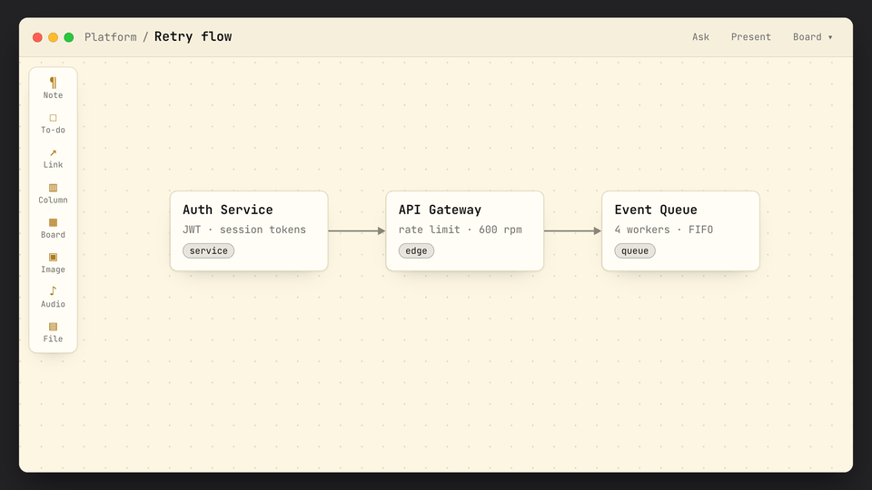

# CXBoards

A local-first visual planning board for macOS, with infinite spatial canvases
that you and your AI agents share live.



<sub>Interactive UI demo with illustrative board data.</sub>

## What's inside

- **Rich canvas cards**: markdown notes (formatting shortcuts and full-screen
  writer), to-do lists, link cards with previews and inline players (YouTube,
  Spotify, SoundCloud, Bandcamp, Vimeo, Apple Music, Maps), images (crop,
  rotate, draw on), audio/video/files streamed in place from disk without
  copying, colour swatches, sketches, procedural animations, columns, nested
  boards and shortcuts, connector lines, labels, and an Unsorted tray.
- **Native macOS shell + local server**: FastAPI + SQLite on `127.0.0.1:4870`
  with a React Flow canvas and SSE live updates. Open it as **CXBoards.app**
  (`app/build-app.sh`) or in any browser at `http://127.0.0.1:4870`. The native
  app adds real file-path resolution for Finder drops, native sheets,
  downloads, and `cxboards://b/<board id>` links.
- **Live agent MCP (`cxboards mcp`)**: a stdio MCP over the same HTTP API with
  layout tools instead of raw coordinates. Agent edits land live on your open
  board, glow as they arrive, and keep their own per-actor undo stack so your
  `⌘Z` never collides with an agent's work.
- **Ask panel (`⌘/`)**: chat with Claude directly on the open board, with
  selected cards and images attached, so it can group, label, sketch, and
  rearrange cards while you watch.
- **214 built-in templates**: 38 categories of YAML board templates plus your
  own reusable boards.
- **Per-board themes**: built-in presets or custom ground, ink, accent, Google
  Fonts, backdrop images, and film/print grain, inherited down child boards
  and applied to the native window chrome and static exports.
- **Safe by design**: soft-delete trash (90 days), per-actor undo/redo,
  search across every board, presentation mode, bookmarklet clipper, and
  exports to Markdown, Word, ZIP, PNG, PDF, vault notes, and script-free static
  HTML snapshots (opt-in per board for [Onyx](https://github.com/cxrobx/onyx)).

## Quick start

```bash
uv venv .venv && uv pip install -e '.[test]'
cd web && npm install && cd ..
scripts/install.sh            # build UI, install the LaunchAgent on 127.0.0.1:4870
app/build-app.sh              # optional: build and install CXBoards.app
claude mcp add -s local cxboards -- "$PWD/.venv/bin/cxboards" mcp
```

Run the test suite:

```bash
.venv/bin/python -m pytest -q
```

See [`CLAUDE.md`](CLAUDE.md) for architecture and invariants, and
[cxventures.io/products/cxboards](https://cxventures.io/products/cxboards) for
an overview.

## License

[Business Source License 1.1](LICENSE), © 2026 CX Ventures LLC. The source is
available and you may use it personally or inside your own organisation.
Selling it, hosting it for others or bundling it into a commercial product
needs a commercial licence. Each version becomes Apache-2.0 on 2030-09-30 or
four years after its release, whichever comes first.
